> **About this research**
>
> This is independent personal research. Everything described here was collected passively. Only data exposed by the criminals' own bots was read. Nothing was sent to them, no stolen credentials were used, no victim funds were touched and no malware was run. Victims' names, e-mails, passwords, codes and phone numbers are masked in every screenshot and message card. Bot tokens are truncated. Crypto figures come from the public blockchain.
{: .prompt-info }

On 3 November at 13:40 UTC, a Telegram bot posted a short message into a private channel:

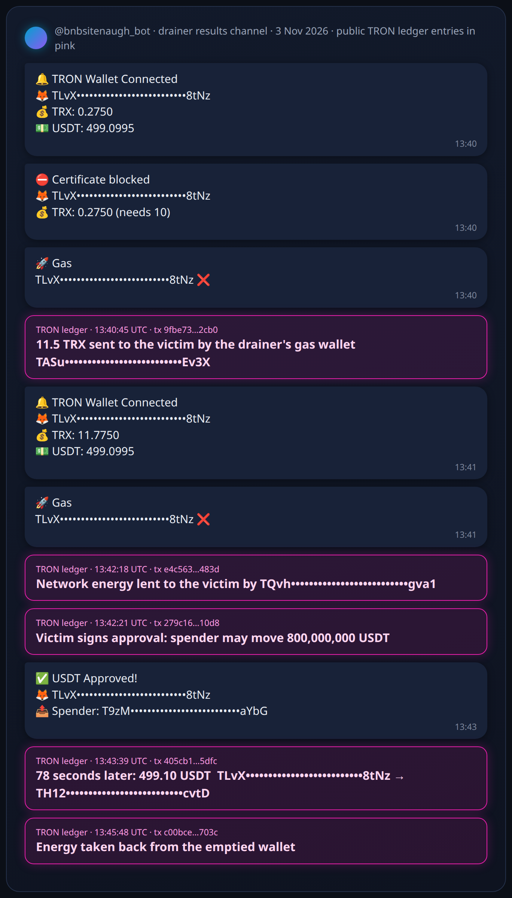

Someone had connected a TRON wallet holding 499 USDT to a fake site. On TRON every transaction is paid for in TRX, the network's own coin, or in "energy", a fee credit that one wallet can lend to another. The victim's wallet held 0.27 TRX, and the bot's *Certificate blocked (needs 10)* shows the kit stopped until there were at least 10. So the operators paid the fee themselves: the public ledger shows 11.5 TRX arriving at 13:40:45 from an address that also appears in the drainer bot's own logs and has sent TRX to 21 wallets, and network energy lent to the victim at 13:42:18 by an address that lends and reclaims energy for 29 wallets. The victim then signed a "verification" that was really an unlimited spending approval. **Seventy-eight seconds later the 499 USDT was gone**, and two minutes after that the borrowed energy was taken back.

The ledger also shows who pulled the trigger. The drainer uses a small set of wallets with fixed jobs: a *gas wallet* (`TASu…Ev3X`) that pays victims' fees, an *energy lender* (`TQvh…gva1`), a *spender contract* (`T9zM…aYbG`) that the victim approves, and a *collection wallet* (`TH12t…cvtD`) where the money ends up. The transfer that emptied the wallet was signed by the gas wallet, 3 minutes after it had paid the victim's fee, and executed through the spender contract:

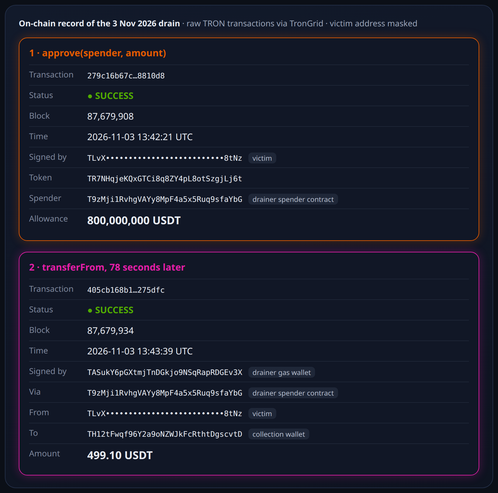
*Raw transaction records from the public TRON ledger. The victim's address is masked, the operators' addresses are not.*

All of this was visible in the criminals' own chat, because the people who built the scam left the key to their back office under the doormat.

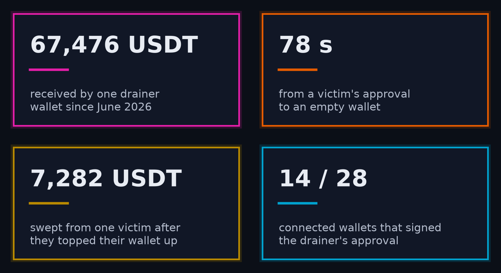

## 1. How a phishing kit hands over the key

Most phishing today runs on *kits*: ZIP archives that clone a bank, a mailbox or a crypto wallet, sold to operators who upload them to cheap hosting and spam the link. When a victim types something in, the kit forwards it to the operator's phone through a Telegram bot within seconds.

To do that, the kit has to contain the bot's token, either in its PHP code or in JavaScript running in the victim's browser. A Telegram bot token works like a password and a username in one string: whoever holds it can talk to the Telegram API as that bot. Kits leak all the time, through open directories, forgotten ZIP files and tokens pasted straight into client-side JavaScript.

For this research a harvester was built. It reads the certificate-transparency stream, the public log of every new TLS certificate (more than **70 million** since that feed was added on 24 October), picks out lookalike domains, crawls the pages, unpacks the kits and pulls out the tokens. Then it does only what a token allows without changing anything: it asks the bot who it is, where it sends data, who is on the other end, and what is being said in the groups and channels where it sits. A bot receives the messages in those chats as "updates" and keeps them queued for up to 24 hours, and the same token can read that queue. Bots that forward everything to their own server through a webhook can't be read this way; for them only the server address and the accounts behind the bot are visible.

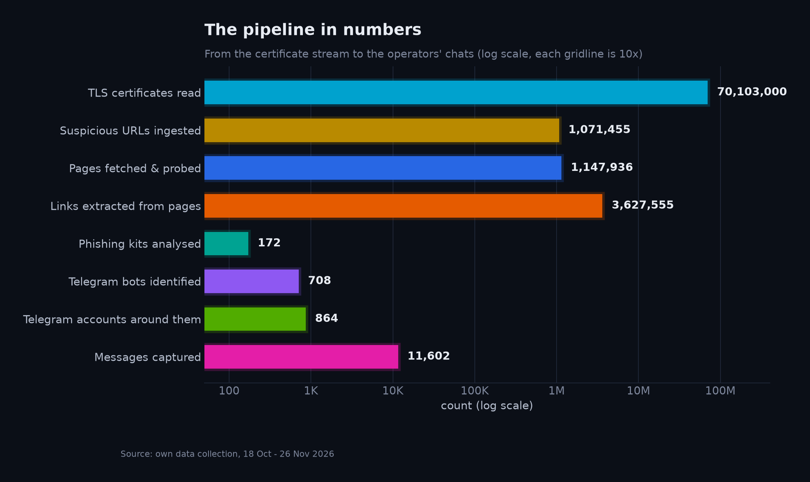

After forty days it had collected **708 bots**, **864 Telegram accounts** around them (the accounts the bots report to, channel admins, and everyone who messaged a bot, including the token hunters described below) and **11,602 messages** from inside their chats. Here is what was in them.

## 2. Follow the money

The bot from the opening is `@bnbsitenaugh_bot`, the reporting channel of a crypto *drainer*. Between 31 October and 19 November it announced **28 connected wallets** on TRON and BNB Chain, holding **1,770 USDT** between them at the moment of connection. At least one of them is the operator's own gas wallet, which the bot reports like any other, most likely from testing. It never signed an approval, so all fourteen approvals came from other wallets. **Fourteen** wallets went on to sign the approval.

The approval is the whole trick. It is a legitimate blockchain function that lets another address move your tokens, and the kit asks for permission to move **800 million USDT**, which in practice means everything, forever. The bot only shows the balance at the moment of connection, so the public TRON ledger was checked for what happened next:

- `TLvX…tNz` approved at 13:42:21 and lost **499.10 USDT** at 13:43:39.
- `THCc…` lost **98 USDT** four minutes after approving on 14 November.
- `TQA1…` showed under 6 USDT when it approved on the evening of 31 October. The approval stayed valid. Fifteen hours later, after the wallet had been topped up again, **7,281.92 USDT** left it in a single transfer.

All three sweeps went to the same collection wallet, `TH12t…cvtD`. Its public history shows the bigger picture:

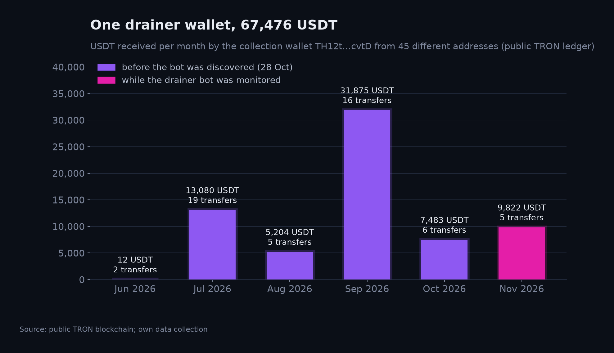

**67,476 USDT from 45 different addresses since June 2026**, with a peak of almost 32,000 in September. Almost none of it was sent by the owners. 50 of the 53 deposits were pulled out of the senders' wallets by the same gas wallet, 47 through the spender contract and 3 through an earlier contract, **67,472 USDT** in total. Only three small transfers worth 4 USDT were ordinary payments. The Telegram chat showed only a small slice of a business that had already been running for four months before the bot was discovered.

On BNB Chain the same operation was less polished. The bot repeatedly reported *"🚀 Auto Gas Failed ⚠️ Sender wallet empty"*: the kit apparently tries to pay the victim's gas fee from a wallet of the operator's so the approval can go through, and that wallet kept running dry. The receive address the crew posted in its channel back in September 2025, nine months before the TRON collection wallet's first deposit, has since sent **2,051 transactions** and today holds one cent, so money only passes through it:

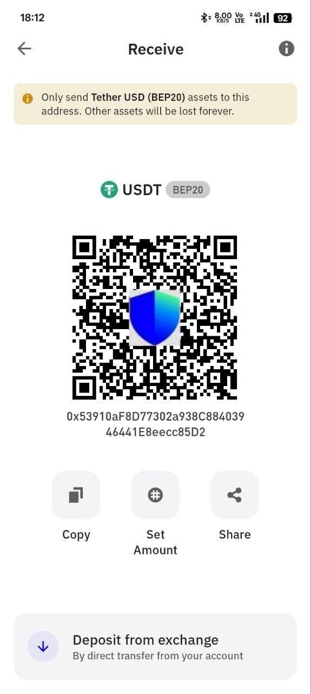
*The receive screen as posted in the drainer channel. The address is in the indicator list at the end.*

### Wallets that come pre-hacked

A quieter variant skips the approval altogether. Five bots (`@Cambwnbot`, `@Yungog512346bot`, `@cashboilog_bot`, `@ocabluee_bot` and `@Drainebypiyush_bot`) report freshly created wallets. The victim is offered a "new wallet" with an address and a seed phrase, and assumes it is theirs. The operator gets this, at the same moment:

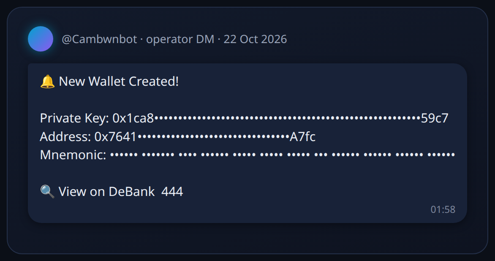

The plan is to wait until the victim funds the wallet and then empty it with the copy of the key. Three of these bots share the same operator account. According to the public chains, none of the five wallets had received anything on BNB Chain, and the three also checked on Ethereum were empty too. The trap was set, but nobody had stepped in it yet.

## 3. Two clicks to lose a business

Another big target is **Meta business accounts**: Facebook pages with advertising budgets and saved payment cards.

Crews mostly writing in Vietnamese run fake "Meta Verified" sites on Vercel and Cloudflare Workers. A victim who falls for one fills in a form, and the crew's bot drops a complete profile into their group:

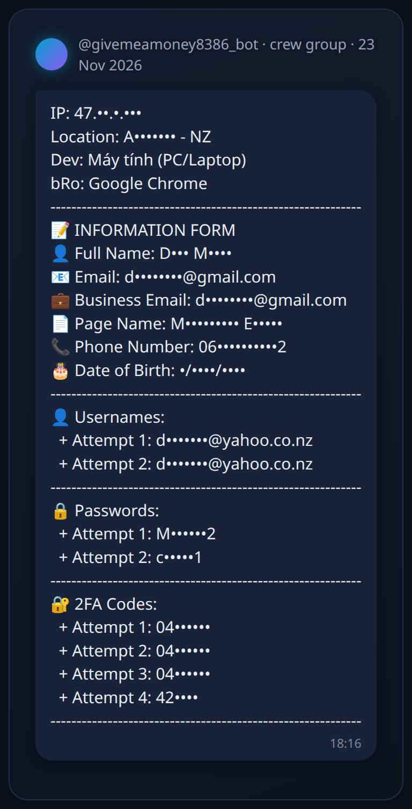

One operator posted a screenshot of their own desktop at exactly this moment. On the left is the victim's verified Facebook page with 75,000 followers; on the right is the bot's "PASSWORD RECOVERY FORM" for the same page, with the owner's name, two e-mail addresses and phone number. The victim had filled it in as an appeal against a supposed trademark complaint:

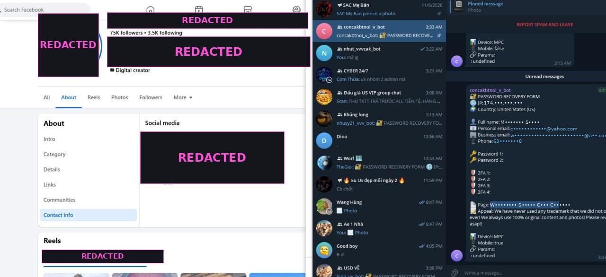
*Page, logo, names, e-mails, phone and IP are masked. The operator's own chat list on the right is left as it was.*

Each record contains the victim's name, date of birth, phone number, business page, IP address, city, device and browser, two password attempts and up to four 2FA codes. The kit asks for the password twice and the code several times, most likely so that a typo doesn't cost the crew the account. The device labels, *Máy tính* (computer) and *Điện thoại* (phone), are in Vietnamese, a sign the kit was built by Vietnamese speakers for their own use. The countries the kit itself recorded for each victim were the **Philippines, Australia, India, New Zealand, Lesotho, Sweden, Israel, Poland, Romania, the US and Vietnam**.

The 2FA code is what makes this work in real time. An operator logs in with the stolen password from their own computer, Facebook sends the real owner a code, and the fake page asks the victim to type in "the code we just sent you". The operators' side of that moment is visible in screenshots they posted to coordinate:

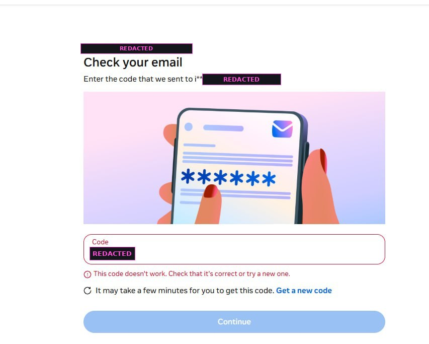
*An Arabic-language business page, mid-takeover. The first code didn't work, and the page simply asks for a new one.*

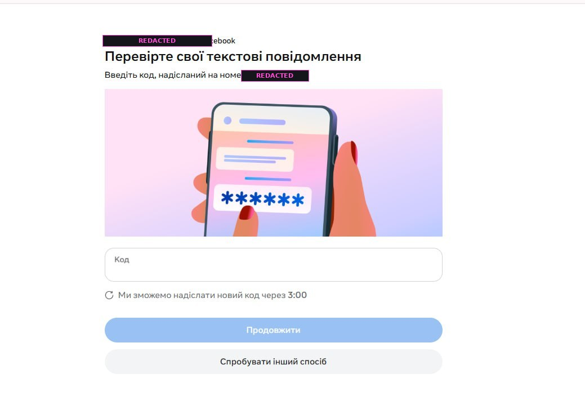
*A Ukrainian account waiting for its SMS code. The same screen also appeared in Arabic, Portuguese, Dutch and English.*

The chat around these screenshots reads like a call-centre floor:

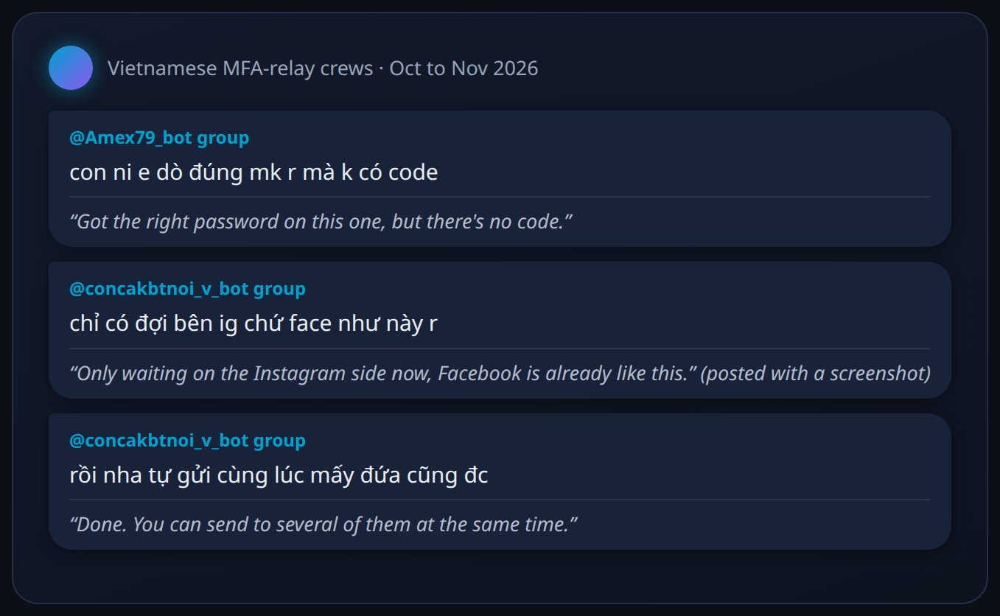

Once inside, the crews check what the account is worth with a browser extension called AdsMeta.io, which shows the ad spending limit, currency, unpaid balance and the account's age:

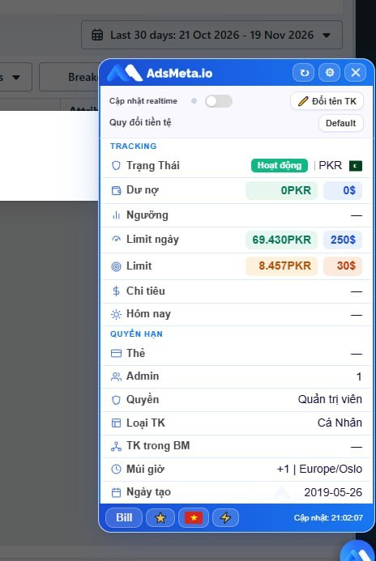
*An ad account from 2019, billed in Pakistani rupees, with admin rights and a daily limit of about 250 USD. Old accounts with a card attached are worth the most.*

The same check on a Brazilian personal account, next to its Meta billing page:

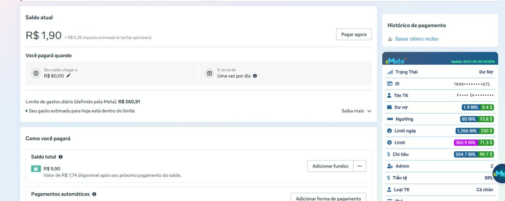
*A daily limit of 1,266 BRL (about 250 USD) and 504.7 BRL already spent. The owner's name and account ID are masked.*

Hijacked ad accounts are typically used to run more scam ads, which bring in more victims. One crew complained in chat that it had already "spent over 30k" and that cards kept failing.

The money ends where it usually does. One of the Vietnamese-speaking crews' groups contains a phone screenshot of an exchange app in Vietnamese, open on the deposit page for USDT on BNB Chain:

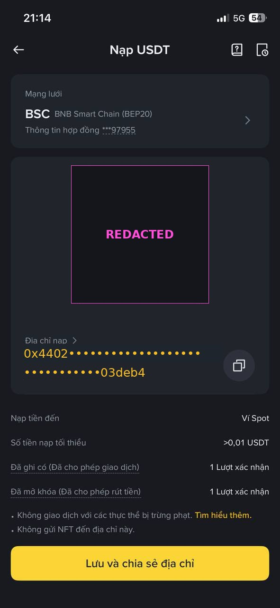
*Deposit address and QR code masked.*

## 4. Forty-two companies in two afternoons

Not every campaign is global. `@xX9MRkTs6a_bot` was built for one target: **Fondeadora**, a Mexican neobank, and specifically its business banking app.

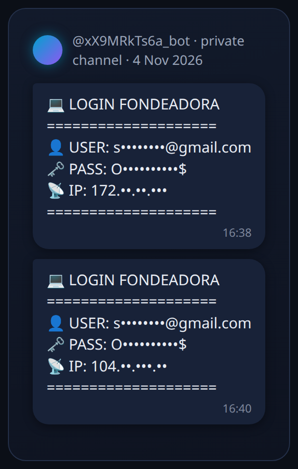

Between 3 and 17 November the bot delivered **100 logs**: 87 logins and 13 "INFO" records with further details, covering **42 different business accounts** from 54 IP addresses. These are submitted logins; the bot doesn't show which of them the crew then used. Almost all of it came in two bursts, 53 logs on 3 and 4 November and 46 on 17 November, which looks like two separate spam waves.

The lures were spread over **17 lookalike domains**, so blocking one changed nothing: typos such as `app-empresariial-fondeadora.com` and `app-emprresarial-fondeadora.com`, the same name under `.info`, `.net`, `.online`, `.xyz` and `.vip`, and the subdomain trick `app-empresarial.fondeadora.br.com`, `.cn.com` and `.co.com`. The results went to a private channel with four members.

## 5. "Email changed. Balance: $8000"

Some messages were short enough to read in a second and impossible to forget.

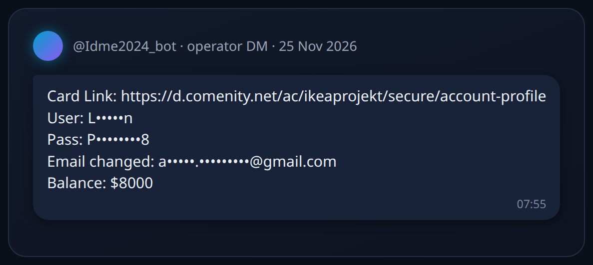

That is an IKEA store credit card (managed by Comenity) taken over and reported to the operator, with the account's e-mail already switched to one the criminal controls and a balance of **8,000 USD**, as the bot reported it. With the e-mail changed, the bank's security notices go to the criminal instead of the owner.

Another operator sent their crew a photo of their own screen. It shows a victim's online banking on a US bank platform, where the operator is replacing the security questions so the owner can't recover the account. Webmail, Amazon Web Services and a second bank are open in other tabs:

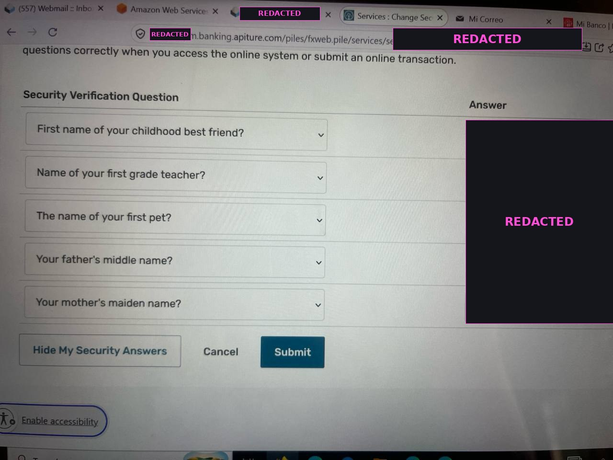
*Bank, request ID, victim company and all answers are redacted. The case is earmarked for notification to the bank through CERT channels.*

Others skip passwords entirely. One bot received a complete set of Instagram session cookies:

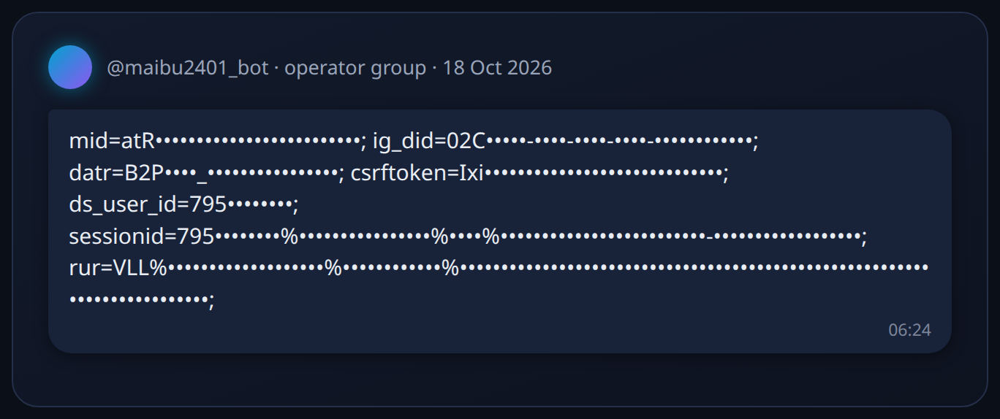

A valid `sessionid` belongs to a session that has already passed the password and 2FA checks, so whoever loads it into a browser can skip both. Instagram may still notice the new device or location and challenge it, but not reliably. In the same week another chat received a blockchain.com login deeplink carrying a session ID.

And sometimes the "phishing" is just a story. One operator's chat contained this ready-made script:

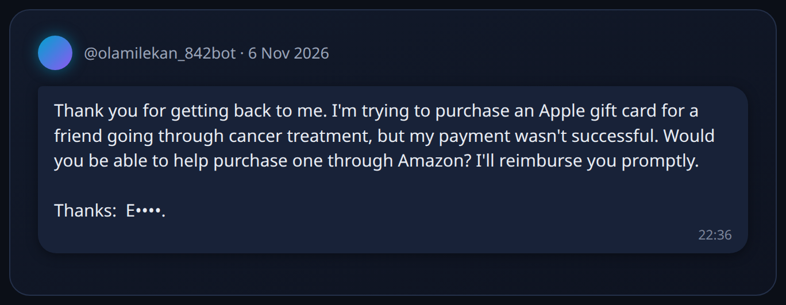

A friend with cancer, a failed payment and a polite request for an Apple gift card. Gift cards are the payment method of choice because they can't be reversed.

## 6. The kit shop

On 24 November between 12:26 and 12:35 UTC, an account called **@Realmovments** sent **16 ZIP files** to `@debo4sky_bot`, a bot that had been monitored since 19 November. The files were retrieved through the same read-only API. It was a ready-to-use collection of US bank and telecom phishing kits:

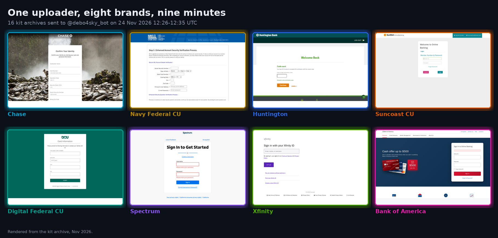

The Bank of America kit was rendered offline. It walks the victim through six screens and sends every one of them to Telegram:

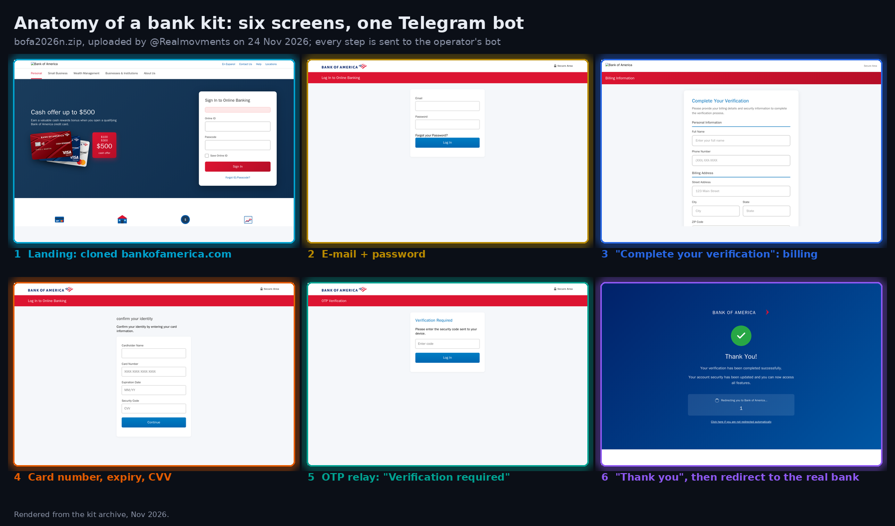

The kits are easy to tell apart, but their contents overlap:

- Seven of them report to `@debo4sky_bot` itself, so the uploader uses one bot as both file storage and results inbox.
- The Chase kit reports to `@EVIL12_bot` ("PIZZA🍕DELIVERY 🚐"). Its destination chat belongs to **@EVILLOADER001**, display name "JONA EXCHANGE".
- Kits for four different credit unions and banks contain the same embedded e-mail addresses, which suggests one developer behind many brands.
- Across all **172 kits** the harvester downloaded from phishing sites, **32 (19 %)** were flagged as backdoored by the harvester's kit analyser: a hidden second token or channel sends a copy of every victim to the kit's author. The criminals who buy kits are being robbed by the people who sell them.

The tooling around the kits is advertised in the same chats, paid for in crypto:

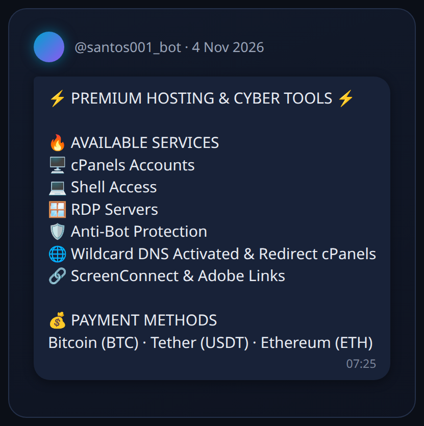

Hacked cPanel accounts to host the pages, shells and RDP servers to run them, anti-bot protection to keep researchers out, and "ScreenConnect & Adobe links", which in this market usually means fake document pages that install remote-access software.

## 7. Thieves robbing thieves

This research was not the only one holding these keys. Split by sender, the messages show **25 accounts** that each messaged at least five different bots, mostly with nothing but `/start`. Together they had already messaged **87 %** of all bots that received any message at all. Some are probably researchers. Others clearly are not.

The less polite ones take the bot over. Setting a webhook on a leaked token silently redirects everything the bot receives, and 18 bots were found pointing to one Cloudflare tunnel at `…/hook.php?bot=NN`, numbered up to at least **89**, three more pointing to a service openly called `tg-token-scrapper`, and five pointing to a free request inspector.

Others monetise the bots directly. **32 hijacked bots** now carry the same referral code in their profile, advertising AI porn sites and "free ChatGPT and Claude keys" to anyone who opens them. Others were rewritten to push fake crypto airdrops and casino apps, and one group even left a signature:

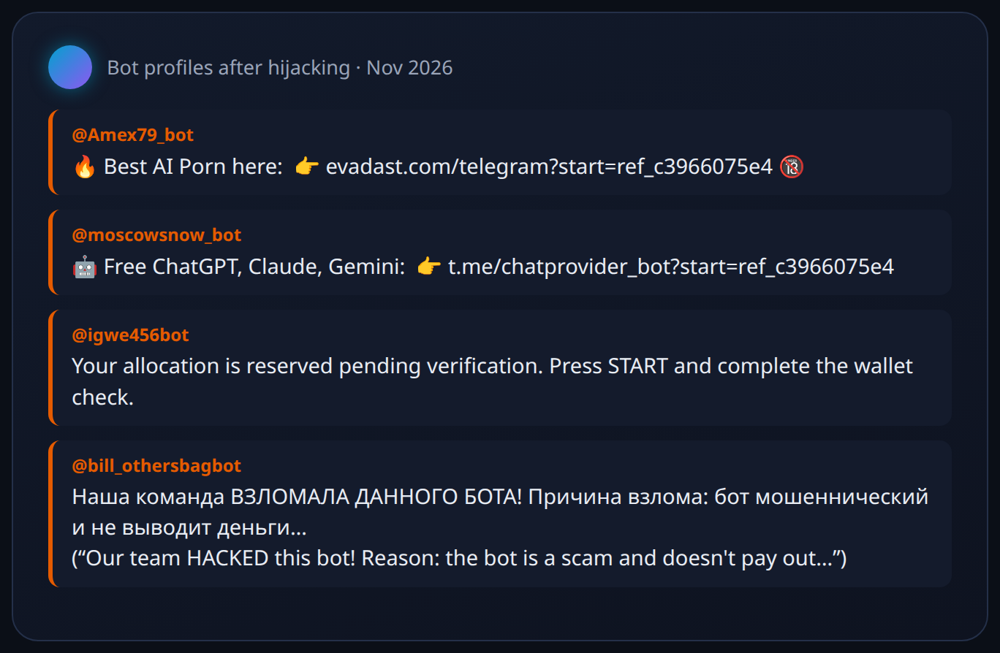

For defenders this is bad news in one specific way. Every hour a leaked token stays active, the victims' data can end up with a second and third set of criminals.

## 8. The creepy corner

Some of the findings have nothing to do with banks.

`@N_hacker_774bot` advertises "INSTAGRAM / SNAPCHAT / CAMERA / FACEBOOK HACK" services. One message in its chat is a link labelled "Youtube subscribe" that points to a Vercel page called `camera-three-fawn`, with the sender's own chat ID in the URL, so whatever the page captures goes back to the person who shared it. The page was not opened.

Another crew posted an Android app called **"Hacker PUBG"**, sold as a game cheat. It was analysed without being installed. It asks for permission to read photos and then uploads the phone's entire gallery, file by file, to a Telegram bot whose owner is the account @M7FA2003. It needs four permissions and about 300 KB of code.

Some screenshots show people rather than accounts. One crew posted a private person's Facebook profile, open in a browser with a Vietnamese interface, with no comment:

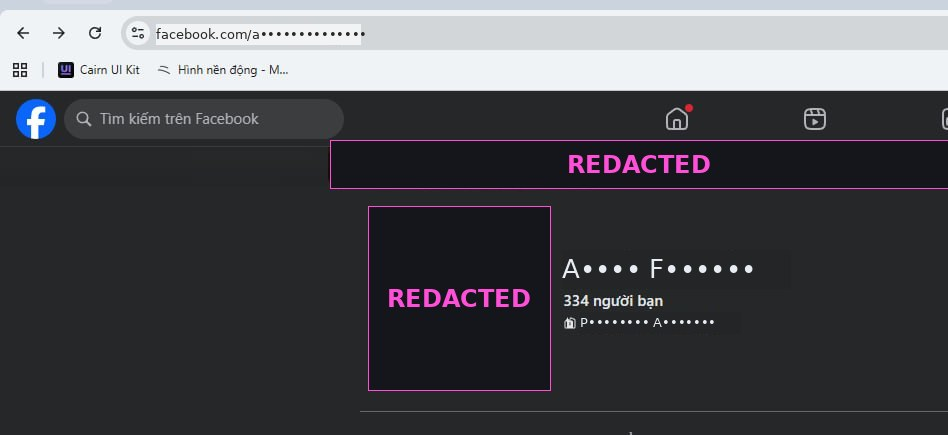
*Photo, name, workplace and profile address are masked.*

The crawled download sites offered more of the same:

- **Ledger Live** (`down.cryptowalletapp[.]cn`): a repackaged copy signed with an empty certificate instead of Ledger's.
- **Telegram** (`securefiledl[.]site`): a modified client that adds a "mining simulator" reporting the user's identity to a server, a remote task controller that can add the account to groups, and a data model for contacts with phone numbers.
- **Casino apps** built by one "APK generator" with a separate ID for each affiliate.

## 9. Who runs it, and when

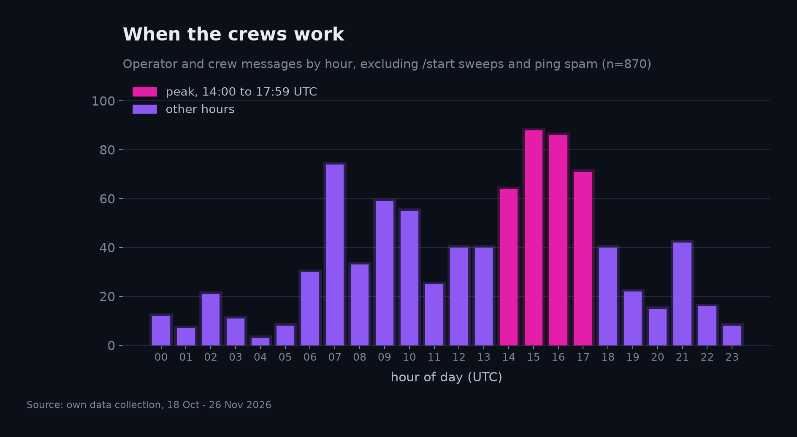

The crews keep office hours. Activity rises from about 06:00 UTC and peaks between 14:00 and 17:00 UTC, which is a working day from mid-afternoon to midnight in **UTC+7**, the time zone of Vietnam and Thailand. That fits the language of the largest crews.

Between the logs, the chats also hold memes, a religious picture and the same spam every Telegram user gets:

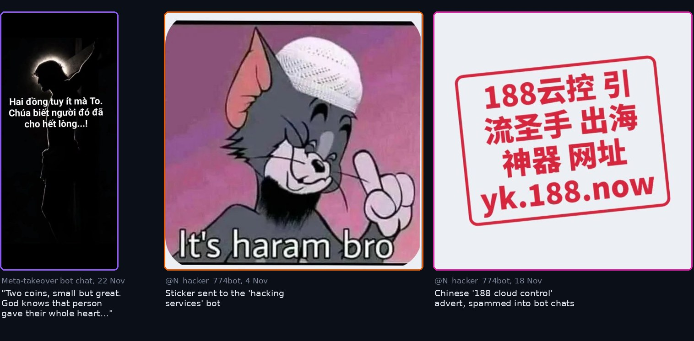

The infrastructure is more concentrated than it looks from outside. **74 of the 120 bots** that push data to a server use the same one, `151.80.232.183:8443` at OVH, which collects data for Microsoft 365 and Roundcube webmail, Poste Italiane, Flipkart, Instagram and IPTV lures alike:

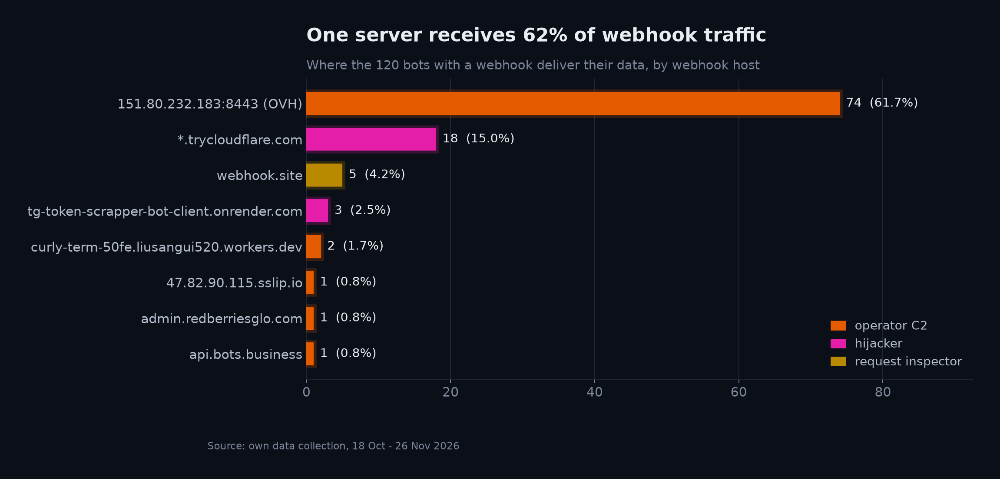

When every bot is linked to its domains, operator accounts, exfil chats and servers, and the token hunters are left out, **339 of the 708 bots** still form one connected web:

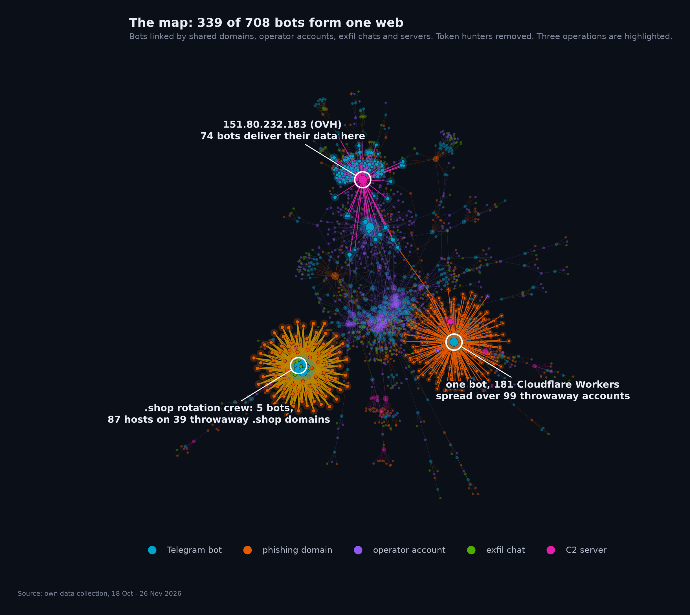

Three operations stand out in it. The OVH server is one. The second is `@BabeStart_bot`, whose token sits on **181 Cloudflare Workers** spread over **99 different Cloudflare accounts**, with names built from word lists (*reprieve*, *mandate*, *sentinel*, *testament*) and new ones appearing from 20 October to 23 November. Each account is free and disposable, so taking one down costs the operator one of ninety-nine. The third is a crew of **five bots** sharing **87 hosts on 39 throwaway .shop domains** with random eight-letter names and date-stamped subdomains such as `2026-8-20-…`, all reporting to the same chats.

Free hosting carries much of the rest. A single free HTML-hosting site, `sharemyhtml.com`, served lure pages for **35 bots**, and one Backblaze B2 cloud-storage host for **22**. For those pages the takedown request goes to a hosting company, not to a domain registrar.

## 10. What could have been done, and wasn't

Holding 708 working bot tokens gives real power, and it is worth stating plainly what was possible:

- **Empty crypto wallets.** The wallet-generator bots exposed private keys and seed phrases. Had any victim funded one, the money could have been moved before the operator got to it.
- **Log in as victims.** More than a hundred fresh e-mail, bank and Facebook credentials passed through the chats, some with 2FA codes attached.
- **Hijack the bots**, as the token hunters do, and cut operators off from their victims.
- **Burn the operators' groups.** The bots sit in 302 groups and channels with 11,527 members and are admins in 19 of them, enough to delete history, ban members or post warnings.
- **Bait the operators** with a tracking link and collect their IP addresses.

None of it was done. The harvester only reads. It never sends a message, never changes a webhook and never uses a credential, key or session it sees. Kits were rendered with their code stripped out, and Android apps were analysed as files. Even the update queue is read without confirming it, so every message stays in place for the operator's own program. The only possible side effect is that if the operator's program polls in the very same moment, one of the two requests is refused and simply retried. Live victims, like the bank session above, are a matter for CERTs and the affected institutions.

## 11. What actually helps

**Report the token, not just the domain.** Domains are replaced in hours, but a revoked token breaks every page that uses it at once. Telegram's abuse process works. Hardly anyone uses it.

**Watch your outbound traffic.** Very few corporate users need `api.telegram.org` or `discord.com/api/webhooks` from a browser or a web server.

**Assume codes get relayed.** SMS and e-mail codes stop bots, not people sitting on the other end of a Telegram group. Passkeys and hardware keys do.

**Treat a token approval like a bank transfer.** "Verify your wallet" on a site you reached through a link is never a verification. Old approvals can be checked and revoked in most wallets or with a revoke tool.

**Protect ad and business accounts as carefully as bank accounts.** For these crews they are worth more.

The criminals in this story are organised and fast, and they share their tools. They are also careless with the one thing that holds it all together. As long as kits keep shipping with their keys inside, someone should keep picking them up.

---

## Appendix: Selected indicators

*Tokens truncated; complete indicators are available to CERTs and abuse teams on request.*

| Type | Indicator | Context |
|---|---|---|
| Drainer wallet | `TH12tFwqf96Y2a9oNZWJkFcRthtDgscvtD` (TRON) | 67,476 USDT received since June 2026 |
| Drainer spender | `T9zMji1RvhgVAYy8MpF4a5x5Ruq9sfaYbG` (TRON) | approval spender used by `@bnbsitenaugh_bot` |
| Drainer wallet | `0x53910aF8D77302a938C88403946441E8eecc85D2` (BSC) | receive address posted by the crew, 2,051 outgoing tx |
| Webhook C2 | `151.80.232.183:8443` (OVH, AS16276) | data intake for 74 bots |
| Hijacker | `*.trycloudflare.com/hook.php?bot=NN` | inventory of at least 89 hijacked bots |
| Bot | `8531880035:AAG…` @Hshshuwusbb_bot | "Hacker PUBG" gallery stealer → @M7FA2003 |
| Bot | `8564963017:AAH…` @EVIL12_bot | Chase kit → @EVILLOADER001 "JONA EXCHANGE" |
| Bot | `6841382514:AAG…` @debo4sky_bot | kit store and results inbox (uploader @Realmovments) |
| Domains | `app-empresarial-fondeadora.com` and 16 variants | Fondeadora business banking lures |
| APK | `f94437c1…3386bba5` | fake Ledger Live (`down.cryptowalletapp[.]cn`) |
| APK | `a8b322af…08638d4f` | modified Telegram (`securefiledl[.]site`) |
| APK | `aea6e85a…b81b9db1` | "Hacker PUBG" gallery stealer |

## Appendix: About the data

The data covers 18 October to 26 November 2026. New domains came from certificate-transparency logs and from public phishing feeds (URLhaus, OpenPhish, Phishunt, TweetFeed and Phishing.Database). Bots were found inside the phishing kits and pages behind those domains.

Every crypto amount stolen or received comes from the public blockchain, so anyone can verify it. The 1,770 USDT figure is what the drainer bot itself reported when victims connected their wallets.

Message cards are recreated from real messages, with every personal detail masked. Screenshots are shown as the operators posted them, with personal data blacked out.
